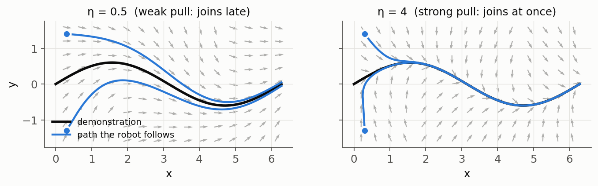
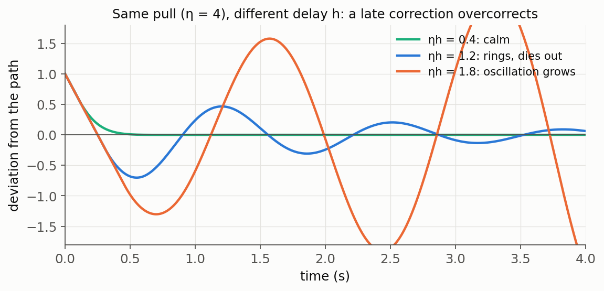
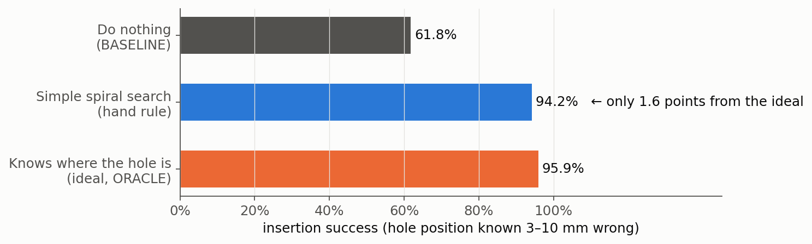
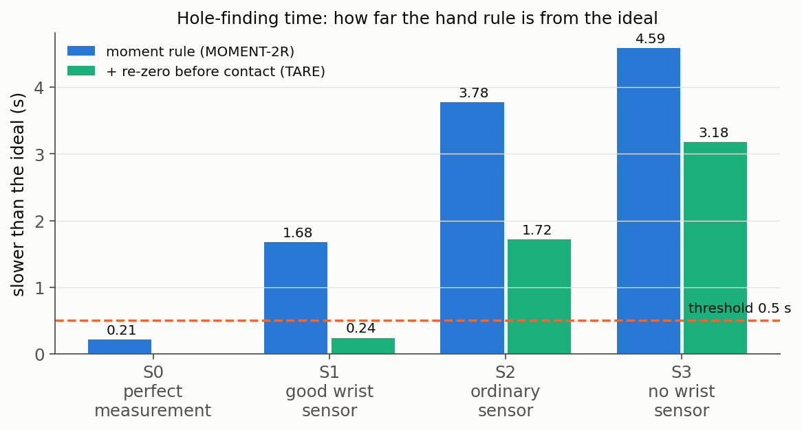

[Türkçe](tr/) · **English**

# Before adding a world model: why simple rules won in six experiments

*We wanted to add a "world model" to a robot that learns stable motion. Before training anything, we measured how
much a model could gain at most. Every time, a rule of a few lines had already taken almost all of it. This post
tells that story as a lesson, with the background you need along the way.*

**Contents**
1. [The basic idea: steering a robot with a vector field](#1-the-basic-idea-steering-a-robot-with-a-vector-field)
2. [BCSDM: learning stable motion from demonstrations](#2-bcsdm-learning-stable-motion-from-demonstrations)
3. [What is a world model, and what is it for?](#3-what-is-a-world-model-and-what-is-it-for)
4. [What we aimed for, and how we measured it](#4-what-we-aimed-for-and-how-we-measured-it)
5. [Six experiments, six lessons](#5-six-experiments-six-lessons)
6. [Conclusion: what we learned, and what we did not](#6-conclusion-what-we-learned-and-what-we-did-not)
7. [Lessons for researchers](#7-lessons-for-researchers)

---

## 1. The basic idea: steering a robot with a vector field

### Motion can be a rule

There are two ways to tell a robot "go from here to there":

- **Trajectory:** write down in advance where it should be at every moment: "here at second 0, there at second
  1…" If the robot is pushed or falls behind, the trajectory does not know.
- **Rule:** say what to do at every point: "wherever you are, move in this direction at this speed." If the robot
  is pushed, it looks at where it is now and applies the rule again.

The second kind is called a **dynamical system**, written in mathematics as:

$$ \dot{x} = f(x) $$

Here $$x$$ is the robot's position and $$\dot{x}$$ its velocity. $$f$$ is a function that assigns a velocity
arrow to every position. When these arrows fill space, they form a **vector field**. Think of a leaf dropped into a
river: wherever it lands, the current carries it somewhere. The robot follows the arrows of the field like the leaf.

### Two parts: imitate, and pull back

Suppose a person shows the robot a motion once (the black curve in the figure below). From this **demonstration** we
can derive two kinds of arrows:

- **Imitation arrow** (*mimicking*): the direction of the demonstration at its nearest point. "Go the way the
  demonstration goes."
- **Pull arrow** (*contracting*): towards the nearest point. "If you drifted away from the curve, come back." The
  farther away, the larger this arrow.

The robot's velocity is the sum of the two:

$$ \dot{x} = \underbrace{m(x)}_{\text{imitate}} + \eta \, \underbrace{c(x)}_{\text{pull}} $$

**η (eta)** is a dial that sets how strong the pull is:

- **Small η** (left): the robot approaches the demonstration slowly and runs alongside it for a long time.
- **Large η** (right): the robot returns to the curve at once and then follows the demonstration.

### Why "stable"?

Let $$D(x)$$ be the robot's distance to the demonstration curve. The imitation arrow runs parallel to the curve
and does not change the distance. The pull arrow shrinks it. In the simple form used in this drawing:

$$ \frac{dD}{dt} = -\eta \, D \quad\Longrightarrow\quad D(t) = D(0)\, e^{-\eta t} $$

So the distance always decreases, exponentially. With $$\eta = 4$$, for example, it halves about every $$0.17$$
seconds ($$\ln 2 / \eta$$). Wherever the robot starts, even if it is pushed, it returns to the curve.

A "distance" or "energy" that always decreases like this is called a **Lyapunov function**. Finding one is the
classical way to show that a system is stable. Picture a ball in a bowl: wherever you put it, its height goes down
and it comes to rest at the bottom.

### But delay can spoil everything

Real robots do not react instantly. The sensor measures, the computer computes, the motor turns: all of this takes
time. Call this delay $$h$$. The robot now corrects based not on where it is, but on where it was $$h$$ seconds
ago:

$$ \dot{x}(t) = -\eta \, x(t - h) $$

It is like setting the water temperature in a shower: you turn the tap, but the hot water arrives late through the
pipe. If you are impatient (large η), you turn too far and the water swings between scalding and freezing.
Mathematics says exactly when: **once $$\eta h$$ exceeds $$\pi/2 \approx 1.57$$**, the corrections turn into
growing oscillations.

An important consequence: **the best η depends on the delay.** With a small delay you can pull hard; with a large one
you must pull gently. This idea comes back again and again in the rest of the post.

---

## 2. BCSDM: learning stable motion from demonstrations

**BCSDM** (Lee et al., *IEEE Transactions on Robotics*, 2026) is a method that does the above for a real robot arm.
It differs from our drawing in three ways:

1. **The space is richer.** Not only the position of the robot's hand matters, but also its orientation (how it is
   turned). Position and orientation together live in a space called **SE(3)**. Distance, imitation and pull arrows
   are defined in that space.
2. **The imitation part is learned.** A neural network learns the imitation field from a few human demonstrations.
3. **Stability is guaranteed.** The pull part and the distance function are built so that, whatever the network
   learns, the robot returns to the demonstration. The flexibility of learning and the guarantee of control theory
   come together.

The result: the robot learns a motion from a few demonstrations and completes it safely even when pushed. In the
paper's real-robot experiment, the robot inserted an umbrella into the hole of a holder. We rebuilt this task in
simulation with a Franka Panda arm, a peg and a holder with a hole. The holder's dimensions are not published, so our
numbers cannot be compared one to one with the paper's.

So what is missing? **Who chooses η?** In the paper, η is fixed by hand. But we saw above that the best η depends on
the delay, the task and the robot. This is where the world model came in.

---

## 3. What is a world model, and what is it for?

A **world model** is the "simulation inside the robot's head". It is a model, learned from data, that answers:

> "If I make this move in the current state, what happens next?"

A robot that knows this answer can **imagine** before it tries:

- **Planning:** it tries a few options in its head and carries out the best one for real, like a chess player
  playing moves out in their head.
- **Choosing settings:** it answers "will I do better with η = 2 or with η = 8?" without trying.
- **Inferring what it cannot see:** it estimates something hidden (say, the exact position of a hole) from the
  forces it feels when it touches.

World models have become very popular in AI. Systems that learn by imagining have produced impressive results in
video games and robotics. But they come at a price: they need a lot of data, they are hard to train, and when they
are wrong, the robot does the wrong thing confidently.

---

## 4. What we aimed for, and how we measured it

### The aim

Our starting idea was:

> BCSDM moves the robot stably. Let us add a small world model on top that chooses η, and other decisions if
> needed, according to the situation. The stability guarantee stays, and the robot becomes more successful and
> faster.

### The method: "measure the gap first"

Training a model can take months. So we first asked: **how much can a model gain at most?**

To measure this, we built three policies in every experiment:

| Policy | What it knows | Role |
|---|---|---|
| **Baseline** | Nothing, a fixed setting | Is there a problem at all? |
| **Hand rule** | A rule of a few lines, no learning | The model's rival |
| **Oracle** | The true state (it cheats) | The best a model could ever reach |

The logic is simple: a perfect world model can be at most as good as the oracle. So:

- **If oracle − hand rule is large**, there is room for a model: it is worth training one.
- **If oracle − hand rule is small**, however good the model is, it can gain little: it is not worth training.

By "hand rule" we mean an instruction such as *"make η smaller the larger the delay"* or *"if you cannot find the
hole, search in a spiral."* No data, no learning, a few constants.

### Three rules for not fooling ourselves

1. **Pre-registration.** Before each experiment we wrote down what we would measure, the threshold, and the rule
   "if this comes out, we decide that". We did not change the rule after seeing results; necessary changes were
   written openly in a "deviations" section.
2. **Testing on fresh data.** We chose settings on one set of conditions and made the decision on conditions never
   seen before.
3. **Independent audit.** After each experiment, a separate auditor who did not know the result checked the code and
   the data from scratch. The audits caught important errors several times and reversed one decision.

In total we ran **more than 600,000 simulation runs** (PyBullet simulation, Franka Panda arm).

---

## 5. Six experiments, six lessons

### Experiment 1: Does a varying η help? (LASA handwriting dataset)

**Question:** Is changing η during the motion (strong at first, gentle later, for example) better than a fixed η?

**Result:** The theory held: stability survives a time-varying η, and the delay limits came out as expected. But there
was no practical gain. On held-out examples, a varying η gave a median difference of **0% to −5%** against a fixed η
chosen per shape; our threshold was 10%.

**Lesson:** That something is possible in theory does not mean it helps. The gain depended on what we measured: large
under one metric, none under another.

### Experiment 2: Who should choose η under delay? (Panda, delay)

**Question:** Under delay and motor lag, should a model choose the best η?

**Result:** At first there was not even a problem: with mid-range η (3–8) there were almost no failures under normal
conditions. A gap appeared when the disturbance came near the end. But what closed it was a one-line rule:

$$ \eta = \min\!\left(20,\ \frac{0.6}{h + \tau}\right) $$

($$h$$: delay, $$\tau$$: the motor's response time.) This follows directly from the shower example above: "with a
large delay, pull gently". On conditions never seen before:

| Policy | Success |
|---|---|
| Fixed η = 8 | 76.6% |
| Best fixed η | 80.1% |
| **One-constant rule** | **85.0%** |
| Best η for each condition separately (close to the oracle) | 86.4% |

The most a model could gain over the rule: **about 1.5 points**.

**Lesson:** When the physics of a problem is known, the answer is often in the physics itself. A model would only have
been needed to estimate the delay, and most robots can measure that anyway.

### Experiment 3: "Stop or go" on learned fields (speed gate)

**Question:** On fields learned by a neural network, when should the robot slow down or wait as it approaches the
hole?

**Result:** A simple speed gate (near the hole, do not advance until you are close enough to the path) raised
success from **85.5% to 96.0%**. An oracle that knew the best decision for every run could add only **0.2–1 point**.

**Lesson:** The flaws of the learned field were less harmful than we expected; a simple safety rule was enough.

### Experiment 4: What if the hole position is known wrong? (insertion with contact)

**Question:** If the hole position is off by 3–10 mm, do we need a model that estimates where the hole is?

**Result:** The problem was real: the baseline that does nothing stayed at 61.8% success. But a 15-line spiral search
raised success to 94.2%. The oracle that knows the hole position exactly is at 95.9%. The **1.6 points** between them
are below our threshold of 3 points.

One thing caught our eye: the oracle went into the hole **1.66 seconds faster**. No difference in success, but maybe
in time.

**Lesson:** "Success" and "speed" are different questions. When one closes, the other can stay open.

### Experiment 5: Finding the hole faster (time)

**Question:** How much faster could a model that estimates the hole's direction from the forces at touch make the
robot?

**Result, in three steps:**
1. A simple moment rule (tell which side the hole is on from the turning effect of the force, then slide that way)
   was **1.21 seconds** behind the oracle. That looked like room for a model.
2. But half of this gap was of a kind no model can take: the oracle knows the hole before it even touches. We built a
   fair ideal: **"an oracle that knows the hole position from the first touch on"**. No touch-based model can beat it.
3. We made the rule a bit smarter: re-aim on every attempt, and estimate the distance from the moment too. This
   **MOMENT-2** came within **only 0.25 seconds** of the fair ideal (threshold 0.5 s).

**Lesson:** Against a weak rival, a model shows a fake gain. Before defending a model, build the best simple rule you
can against it.

### Experiment 6: With a realistic sensor (sensor errors)

**Question:** In the previous experiment, forces were measured perfectly. A real wrist force sensor sits about 35 cm
above the peg's tip and makes errors: noise, drift (bias), misalignment. Does the rule survive these errors?

We tried three levels: **S1** a good wrist sensor, **S2** an ordinary sensor, **S3** no wrist sensor.

**Result:**
- The rule broke down. Even with a good sensor, it fell **1.68 seconds** behind the ideal. Why: the sensor's small
  constant drift grows along the 35 cm lever and made the rule misjudge the hole's direction.
- The independent auditor suggested a simple fix: **re-zero the sensor in the air, just before the peg touches.** This
  removes the drift from the measurements.
- With this single step, the gap with a good sensor fell to **0.24 seconds**.
- With an ordinary sensor (1.72 s) and with no wrist sensor (3.18 s), the gap halved but did not close.

**Lesson:** What a simulation leaves "perfect" can change the result. And again: when a new problem appears, look for
the simple fix before the model.

### Summary table

| Experiment | Question | Gap between oracle and hand rule | Model needed? |
|---|---|---|---|
| 1. Varying η | Changing η over time | 0% to −5% gain | No |
| 2. Delay | Choosing η by delay | ≈1.5 points | No: one-constant rule |
| 3. Speed gate | When to advance | 0.2–1 point | No: speed gate |
| 4. Contact | Knowing the hole position | 1.6 points | No: spiral search |
| 5. Time | Finding the hole fast | 0.25 s | No: MOMENT-2 |
| 6. Sensor (good) | Realistic measurement error | 0.24 s | Probably not: re-zeroing |
| 6. Sensor (poor / none) | Realistic measurement error | 1.7–3.2 s | **Open question** |

---

## 6. Conclusion: what we learned, and what we did not

### What we learned

- **In this simulation we found no defensible place for a world model.** Every door we opened was closed by a rule of
  a few lines.
- **BCSDM itself is solid.** The stability guarantee worked as expected; what turned out unnecessary was the model we
  wanted to add on top.
- **The one open door:** a poor sensor, or none at all. Even after re-zeroing, a gap of 1.7–3.2 seconds remains there.
  That is the first defensible place for a learned estimator. Still, a better hand rule should be tried first.

### What we did not learn (limits)

- **What happens on a real robot.** Everything was in simulation. The sensor error levels are our assumptions, not
  measurements.
- **The simulation uses perfect geometry.** No tilted holes, no chamfers, no flexible parts.
- **The re-zeroing assumption.** The good-sensor result assumes that re-zeroing just before contact can remove the
  drift. If a real sensor drifts faster than that, the result may differ.
- **One task family.** Peg-in-hole and path following. The picture may differ for tasks that need long-horizon
  planning.
- **We never trained a world model.** On purpose: the gaps we measured were too small to be worth it.

---

## 7. Lessons for researchers

1. **Measure the gap before training a model.** The difference between an oracle and a simple rule is an upper bound
   on what a model can gain. Measuring it is far cheaper than training a model.
2. **Make the rival strong.** Against a weak rival, any model looks good. In our experiment, making the simple rule a
   little smarter wiped out three quarters of the model's "gain".
3. **Make the oracle fair.** An oracle that uses information no model could have makes the gap look bigger than it
   is.
4. **Write the decision down in advance.** Changing the rule after seeing the result is the easiest way to fool
   yourself.
5. **Add an independent pair of eyes.** For us, an audit reversed one decision and found the gap that settled one
   experiment's outcome.
6. **A negative result is a result.** Saying "no model is needed here" can save other people months.

---

### References and code

- BCSDM: Lee et al., *IEEE Transactions on Robotics*, 2026.
- Protocols, code and results of the experiments: [github.com/burhanbarakli/before-world-models](https://github.com/burhanbarakli/before-world-models)

### Small glossary

| Term | Meaning |
|---|---|
| Dynamical system | A rule that says what to do at every position: $$\dot{x} = f(x)$$ |
| Vector field | A space with a velocity arrow at every point |
| Lyapunov function | A "distance" or "energy" that always decreases; proof of stability |
| η (eta) | How strongly the robot is pulled back to the demonstration |
| Delay (h) | The time between measuring and reacting |
| World model | A learned model that answers "what happens if I do this?" |
| Oracle | An ideal policy that knows the true state (it cheats); an upper bound for a model |
| Hand rule | A rule of a few lines, with no learning |
| Pre-registration | Writing down the decision rule before the experiment |
