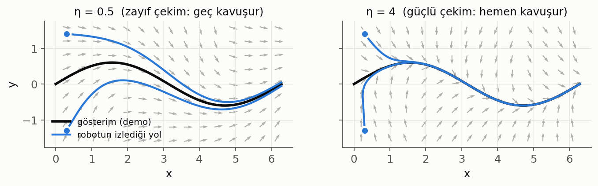
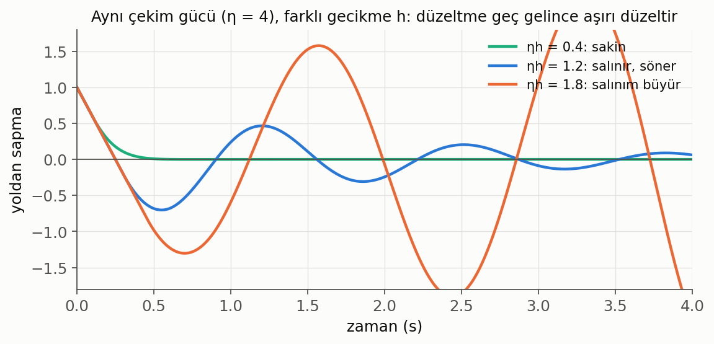
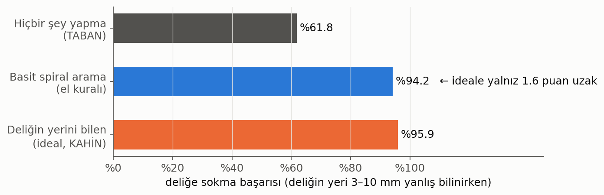
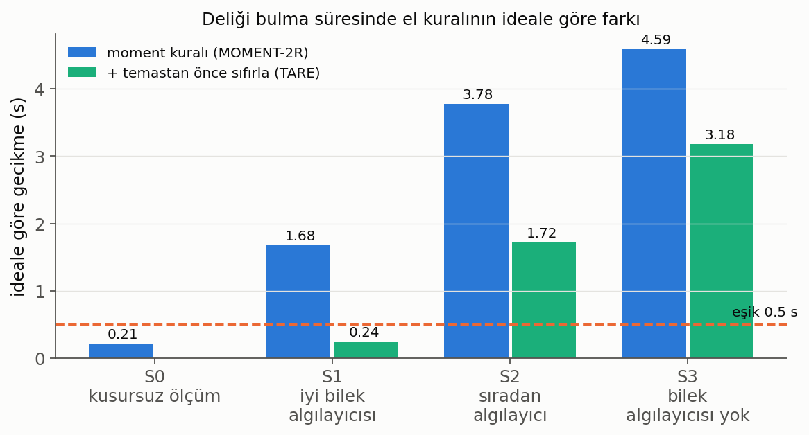

**Türkçe** · [English](../)

# Dünya modeli eklemeden önce: altı deneyde basit kurallar neden yetti?

*Kararlı hareket öğrenen bir robota "dünya modeli" eklemek istedik. Önce bir modelin en fazla ne kazanabileceğini
ölçtük. Her seferinde birkaç satırlık bir kural, modelin kazanabileceği şeyin neredeyse tamamını zaten aldı. Bu yazı
o yolculuğu, gerekli temel bilgilerle birlikte, ders gibi anlatıyor.*

**İçindekiler**
1. [Temel fikir: robotu bir vektör alanıyla yönetmek](#1-temel-fikir-robotu-bir-vektör-alanıyla-yönetmek)
2. [BCSDM: gösterimden kararlı hareket öğrenmek](#2-bcsdm-gösterimden-kararlı-hareket-öğrenmek)
3. [Dünya modeli nedir, ne işe yarar?](#3-dünya-modeli-nedir-ne-işe-yarar)
4. [Biz ne amaçladık ve nasıl ölçtük?](#4-biz-ne-amaçladık-ve-nasıl-ölçtük)
5. [Altı deney, altı ders](#5-altı-deney-altı-ders)
6. [Sonuç: ne öğrendik, ne öğrenmedik](#6-sonuç-ne-öğrendik-ne-öğrenmedik)
7. [Araştırmacılar için dersler](#7-araştırmacılar-için-dersler)

---

## 1. Temel fikir: robotu bir vektör alanıyla yönetmek

### Hareket bir "kural" olabilir

Bir robota "şu noktadan şu noktaya git" demenin iki yolu var:

- **Yörünge:** her an nerede olacağını önceden yaz: "0. saniyede burada, 1. saniyede şurada…" Robot itilirse ya da
  geç kalırsa yörünge bunu bilmez.
- **Kural:** her noktada ne yapacağını söyle: "Neredeysen, şu yöne şu hızla git." Robot itilse de nerede olduğuna
  bakar ve kuralı yeniden uygular.

İkincisine **dinamik sistem** denir ve matematikte şöyle yazılır:

$$ \dot{x} = f(x) $$

Burada $$x$$ robotun konumu, $$\dot{x}$$ hızı. $$f$$ her konuma bir hız oku atayan bir fonksiyon. Bu oklar
uzayı kaplayınca bir **vektör alanı** oluşur. Akıntılı bir nehre bırakılan yaprak düşünün: yaprak nereye
bırakılırsa bırakılsın, akıntı onu bir yere taşır. Robot da yaprak gibi alanın oklarını izler.

### İki parça: taklit et ve geri çek

Bir insanın robota hareketi bir kez gösterdiğini düşünelim (aşağıdaki şekilde siyah eğri). Bu **gösterimden** iki ok
türetebiliriz:

- **Taklit oku** (*mimicking*): gösterim eğrisinin en yakın noktasındaki yönü. "Gösterimin gittiği yöne git."
- **Çekme oku** (*contracting*): en yakın noktaya doğru. "Eğriden uzaklaştıysan geri dön." Uzaklık büyüdükçe bu ok
  da büyür.

Robotun hızı bu ikisinin toplamıdır:

$$ \dot{x} = \underbrace{m(x)}_{\text{taklit}} + \eta \, \underbrace{c(x)}_{\text{çekme}} $$

**η (eta)**, çekmenin ne kadar güçlü olduğunu ayarlayan bir düğmedir:

- **Küçük η** (soldaki şekil): robot gösterime yavaş yaklaşır, uzun süre yanında paralel gider.
- **Büyük η** (sağdaki şekil): robot hemen eğriye döner ve oradan gösterimi izler.

### Neden "kararlı"?

$$D(x)$$, robotun gösterim eğrisine uzaklığı olsun. Taklit oku eğriye paraleldir, uzaklığı değiştirmez. Çekme oku
ise uzaklığı küçültür. Bu basit çizimdeki hâliyle:

$$ \frac{dD}{dt} = -\eta \, D \quad\Longrightarrow\quad D(t) = D(0)\, e^{-\eta t} $$

Yani uzaklık her zaman azalır, üstel olarak. Örneğin $$\eta = 4$$ ise yaklaşık her $$0.17$$ saniyede yarıya
iner ($$\ln 2 / \eta$$). Robot nereden başlarsa başlasın, itilse bile, eğriye geri döner.

Hep azalan böyle bir "uzaklık" ya da "enerji" fonksiyonuna **Lyapunov fonksiyonu** denir. Bir sistemin kararlı
olduğunu göstermenin klasik yolu, böyle bir fonksiyon bulmaktır: içinde top olan bir kâse düşünün. Top nereye
konursa konsun yüksekliği azalır ve dipte durur.

### Ama gecikme her şeyi bozabilir

Gerçek robotlar anında tepki vermez. Algılayıcı ölçer, bilgisayar hesaplar, motor döner: bunların hepsi zaman alır.
Bu gecikmeye $$h$$ diyelim. Robot artık şimdiki konumuna değil, $$h$$ saniye önceki konumuna göre düzeltme yapar:

$$ \dot{x}(t) = -\eta \, x(t - h) $$

Duşta suyun sıcaklığını ayarlamak gibi: musluğu çevirirsiniz, ama sıcak su borudan geç gelir. Sabırsızsanız
(büyük η) fazla çevirirsiniz ve su bir yanar bir donar. Matematik bunu tam olarak söyler: **$$\eta h$$ değeri $$\pi/2 \approx 1.57$$'yi
aşınca** düzeltmeler büyüyen salınımlara dönüşür.

Buradan önemli bir sonuç çıkar: **en iyi η, gecikmeye bağlıdır.** Gecikme küçükse güçlü çekebilirsiniz; büyükse
yumuşak çekmeniz gerekir. Yazının geri kalanında bu fikir sık sık karşımıza çıkacak.

---

## 2. BCSDM: gösterimden kararlı hareket öğrenmek

**BCSDM** (Lee ve ark., *IEEE Transactions on Robotics*, 2026), yukarıdaki fikri gerçek bir robot kolu için
yapan bir yöntemdir. Bizim çizimimizden üç farkı var:

1. **Uzay daha zengin.** Robot elinin yalnız konumu değil, yönelimi (nasıl döndüğü) de önemlidir. Konum ve yönelim
   birlikte **SE(3)** denen bir uzayda yaşar. Uzaklık, taklit ve çekme okları bu uzayda tanımlanır.
2. **Taklit kısmı öğrenilir.** Birkaç insan gösteriminden bir sinir ağı, taklit alanını öğrenir.
3. **Kararlılık garanti edilir.** Çekme kısmı ve uzaklık fonksiyonu öyle kurulur ki, sinir ağı ne öğrenirse öğrensin,
   robot gösterime geri döner. Yani öğrenmenin esnekliği ile kontrol teorisinin güvencesi bir arada.

Sonuç: robot bir hareketi birkaç gösterimden öğrenir ve itilse bile güvenle tamamlar. Makalenin gerçek robot
deneyinde robot bir şemsiyeyi bir tutucunun deliğine sokuyordu. Biz bu görevi benzetimde, Franka Panda koluyla bir
pim ve delikli bir tutucu kullanarak yeniden kurduk. Tutucunun ölçüleri yayımlanmadığı için sayılar makaleyle birebir
karşılaştırılamaz.

Peki eksik ne? **η'yı kim seçiyor?** Makalede η elle, sabit seçilir. Ama yukarıda gördük: en iyi η gecikmeye, göreve,
robota bağlı. Burada aklımıza dünya modeli geldi.

---

## 3. Dünya modeli nedir, ne işe yarar?

**Dünya modeli**, robotun "kafasının içindeki benzetim"dir. Şu soruyu yanıtlayan, veriden öğrenilmiş bir modeldir:

> "Şu anki durumda şu hareketi yaparsam, bir sonraki an ne olur?"

Bu yanıtı bilen bir robot, bir şeyi denemeden önce **hayal edebilir**:

- **Planlama:** birkaç seçeneği kafasında dener, en iyisini gerçekte uygular. Satranç oyuncusunun hamleleri kafasında
  oynaması gibi.
- **Ayar seçme:** "η = 2 ile mi, η = 8 ile mi daha iyi giderim?" sorusunu denemeden yanıtlar.
- **Görünmeyeni tahmin etme:** göremediği bir şeyi (örneğin deliğin tam yerini) dokunduğu andaki kuvvetlerden
  kestirir.

Dünya modelleri son yıllarda yapay zekâda çok popüler. Video oyunlarında ve robotikte hayal ederek öğrenen sistemler
etkileyici sonuçlar verdi. Ama bir bedelleri var: çok veri isterler, eğitmesi zordur ve yanıldıklarında robot
kendinden emin bir şekilde yanlış şey yapar.

---

## 4. Biz ne amaçladık ve nasıl ölçtük?

### Amaç

Başlangıç fikrimiz şuydu:

> BCSDM robotu kararlı bir şekilde götürüyor. Üstüne küçük bir dünya modeli ekleyelim; η'yı ve gerekirse başka
> kararları duruma göre seçsin. Kararlılık garantisi korunurken robot daha başarılı ve daha hızlı olsun.

### Yöntem: "önce boşluğu ölç"

Model eğitmek aylar sürebilir. Bu yüzden önce şunu sorduk: **bir model en fazla ne kazanabilir?**

Bunu ölçmek için her deneyde üç politika kurduk:

| Politika | Ne bilir? | Rolü |
|---|---|---|
| **Taban** | Hiçbir şey, sabit ayar | Sorun var mı? |
| **El kuralı** | Birkaç satırlık, öğrenmesiz bir kural | Modelin rakibi |
| **Kâhin** | Gerçek durumu tam bilir (hile yapar) | Bir modelin ulaşabileceği en iyi yer |

Mantık basit: kusursuz bir dünya modeli olsa olsa kâhin kadar iyi olabilir. O hâlde:

- **Kâhin − el kuralı büyükse**, bir modele yer var: modeli eğitmeye değer.
- **Kâhin − el kuralı küçükse**, model ne kadar iyi olursa olsun kazanabileceği şey azdır: eğitmeye değmez.

"El kuralı" dediğimiz şey, örneğin şu tür bir talimat: *"Gecikme ne kadarsa η'yı ona göre küçült"* ya da *"Deliği
bulamazsan spiral çizerek ara."* Veri yok, öğrenme yok, birkaç sabit sayı var.

### Kendimizi kandırmamak için üç kural

1. **Önceden kayıt.** Her deneyden önce ne ölçeceğimizi, eşiği ve "şu çıkarsa şu kararı veririz" kuralını yazdık.
   Sonuçları gördükten sonra kuralı değiştirmedik; zorunlu değişiklikleri "sapmalar" bölümünde açıkça yazdık.
2. **Yeni veriyle sınama.** Ayarları bir veri kümesinde seçtik, kararı hiç görülmemiş koşullarda verdik.
3. **Bağımsız denetim.** Her deneyden sonra sonucu bilmeyen ayrı bir denetçi, kodu ve veriyi baştan kontrol etti.
   Denetim birkaç kez önemli hatalar yakaladı ve bir kararı tersine çevirdi.

Toplamda **600.000'den fazla benzetim koşusu** yaptık (PyBullet benzetimi, Franka Panda kolu).

---

## 5. Altı deney, altı ders

### Deney 1: Değişken η işe yarar mı? (LASA el yazısı veri kümesi)

**Soru:** η'yı hareket boyunca değiştirmek (başta güçlü, sonra yumuşak gibi), sabit bir η'dan daha iyi mi?

**Sonuç:** Teori tuttu: η zamanla değişse de kararlılık korunuyor ve gecikmeyle ilgili sınırlar beklendiği gibi
çıktı. Ama pratik kazanç yoktu. Ayrılmış örneklerde değişken η, şekil başına seçilmiş sabit bir η'ya göre
ortanca **%0 ile −%5** fark verdi; eşiğimiz %10'du.

**Ders:** Bir şeyin teoride mümkün olması, işe yaradığı anlamına gelmez. Kazanç neyi ölçtüğünüze bağlıydı: bir
ölçütte büyük kazanç vardı, ötekinde hiç yoktu.

### Deney 2: Gecikmede η'yı kim seçmeli? (Panda, gecikme)

**Soru:** Gecikme ve tepki gecikmesi altında, en iyi η'yı bir model mi seçmeli?

**Sonuç:** Önce sorun bile çıkmadı: orta değerli η'larla (3–8) normal koşullarda neredeyse hiç başarısızlık yoktu.
Bozucuyu sona yakın verince fark oluştu. Ama farkı kapatan şey tek satırlık bir kuraldı:

$$ \eta = \min\!\left(20,\ \frac{0.6}{h + \tau}\right) $$

($$h$$: gecikme, $$\tau$$: motorun tepki süresi.) Bu, yukarıdaki duş örneğinin doğrudan sonucu: "gecikme büyükse
yumuşak çek". Hiç görülmemiş koşullarda:

| Politika | Başarı |
|---|---|
| Sabit η = 8 | %76.6 |
| En iyi sabit η | %80.1 |
| **Tek sabitli kural** | **%85.0** |
| Her koşul için ayrı en iyi η (kâhine yakın) | %86.4 |

Bir modelin kurala karşı kazanabileceği en fazla **yaklaşık 1.5 puan**.

**Ders:** Fiziği bilinen bir sorunun cevabı çoğu zaman fiziğin kendisinde. Model yalnız gecikmeyi kestirmek için
gerekirdi; o da çoğu robotta zaten ölçülebilir.

### Deney 3: Öğrenilmiş alanlarda "dur ya da devam et" (hız kapısı)

**Soru:** Sinir ağıyla öğrenilmiş alanlarda robot, deliğe yaklaşırken ne zaman yavaşlamalı ya da beklemeli?

**Sonuç:** Basit bir hız kapısı (deliğe yakınken, yola yeterince yaklaşmadan ilerleme) başarıyı **%85.5'ten
%96.0'a** çıkardı. Her koşu için en iyi kararı bilen kâhin buna yalnız **0.2–1 puan** ekleyebiliyordu.

**Ders:** Öğrenilmiş alanın kusurları beklediğimiz kadar zararlı değildi; basit bir güvenlik kuralı yetti.

### Deney 4: Deliğin yeri yanlış bilinirse? (temaslı sokma)

**Soru:** Deliğin konumu 3–10 mm yanlış biliniyorsa, deliğin yerini tahmin eden bir model gerekir mi?

**Sonuç:** Sorun gerçekti: hiçbir şey yapmayan taban %61.8 başarıyla kaldı. Ama 15 satırlık bir spiral arama
başarıyı %94.2'ye çıkardı. Deliğin yerini tam bilen kâhin %95.9'da. Aradaki **1.6 puan**, eşiğimiz olan 3 puanın
altında.

Bir şey dikkatimizi çekti: kâhin deliğe **1.66 saniye daha hızlı** giriyordu. Başarı açısından fark yoktu, ama süre
açısından olabilirdi.

**Ders:** "Başarı" ile "hız" farklı sorular. Biri kapanınca öteki açık kalabilir.

### Deney 5: Deliği daha hızlı bulmak (süre)

**Soru:** Değdiği andaki kuvvetlerden deliğin yönünü kestiren bir model, robotu ne kadar hızlandırabilir?

**Sonuç, üç adımda:**
1. Basit bir moment kuralı (kuvvetin yarattığı dönme etkisinden deliğin hangi yanda olduğunu anlayıp o yöne kaymak)
   kâhinden **1.21 saniye** geride kaldı. Bu, modele yer var gibi görünüyordu.
2. Ama bu farkın yarısı hiçbir modelin alamayacağı türdendi: kâhin deliği daha dokunmadan biliyor. Adil bir ideal
   kurduk: **"ilk dokunuştan itibaren deliğin yerini bilen kâhin"**. Hiçbir dokunma tabanlı model bundan iyi olamaz.
3. Kuralı biraz akıllandırdık: her denemede yeniden nişan al, uzaklığı da momentten kestir. Bu **MOMENT-2**, adil
   ideale **yalnız 0.25 saniye** yaklaştı (eşik 0.5 s).

**Ders:** Rakip zayıfsa model sahte bir kazanç gösterir. Bir modeli savunmadan önce, ona karşı yapılabilecek en iyi
basit kuralı kurmak gerekir.

### Deney 6: Gerçekçi bir algılayıcıyla (algılayıcı hataları)

**Soru:** Önceki deneyde kuvvetler kusursuz ölçülüyordu. Gerçek bir bilek kuvvet algılayıcısı, pimin ucundan yaklaşık
35 cm yukarıda durur ve hata yapar: gürültü, kayma (sapma), hizalama hatası. Kural bu hatalara dayanıyor mu?

Üç düzey denedik: **S1** iyi bir bilek algılayıcısı, **S2** sıradan bir algılayıcı, **S3** bilek algılayıcısı yok.

**Sonuç:**
- Kural çöktü. İyi algılayıcıda bile ideale **1.68 saniye** fark açıldı. Neden: algılayıcının küçük sabit kayması,
  35 cm'lik kolla büyüyor ve kuralın deliğin yönünü yanlış kestirmesine yol açıyordu.
- Bağımsız denetçi basit bir çare önerdi: **pim deliğe değmeden hemen önce, havadayken algılayıcıyı sıfırla.** Böylece
  kayma ölçümlerden çıkarılıyor.
- Bu tek adımla iyi algılayıcıdaki fark **0.24 saniyeye** indi.
- Sıradan algılayıcıda (1.72 s) ve algılayıcı yokken (3.18 s) fark yarıya indi ama kapanmadı.

**Ders:** Benzetimin "kusursuz" bıraktığı yerler, sonucu değiştirebilir. Ve yine: yeni bir sorun çıktığında, modelden
önce basit çareye bakmak gerekir.

### Özet tablo

| Deney | Soru | Kâhin ile el kuralı arasındaki fark | Model gerekli mi? |
|---|---|---|---|
| 1. Değişken η | η'yı zamanla değiştirmek | %0 ile −%5 kazanç | Hayır |
| 2. Gecikme | η'yı gecikmeye göre seçmek | ≈1.5 puan | Hayır: tek sabitli kural |
| 3. Hız kapısı | Ne zaman ilerlemeli | 0.2–1 puan | Hayır: hız kapısı |
| 4. Temas | Deliğin yerini bilmek | 1.6 puan | Hayır: spiral arama |
| 5. Süre | Deliği hızlı bulmak | 0.25 s | Hayır: MOMENT-2 |
| 6. Algılayıcı (iyi) | Gerçekçi ölçüm hatası | 0.24 s | Büyük olasılıkla hayır: sıfırlama |
| 6. Algılayıcı (kötü / yok) | Gerçekçi ölçüm hatası | 1.7–3.2 s | **Açık soru** |

---

## 6. Sonuç: ne öğrendik, ne öğrenmedik

### Öğrendiklerimiz

- **Bu benzetimde dünya modeline savunulabilir bir yer bulamadık.** Açtığımız her kapıyı birkaç satırlık bir kural
  kapattı.
- **BCSDM'nin kendisi sağlam.** Kararlılık garantisi beklendiği gibi çalıştı; sorun onun üstüne eklemek istediğimiz
  modelin gereksizliğiydi.
- **Tek açık kapı:** algılayıcının kötü olduğu ya da hiç olmadığı durum. Orada sıfırlamadan sonra bile 1.7–3.2
  saniyelik fark kalıyor. Bir öğrenilmiş tahmincinin ilk savunulabilir yeri burası. Yine de önce daha iyi bir el
  kuralı denenmeli.

### Öğrenmediklerimiz (sınırlar)

- **Gerçek robotta ne olacağını.** Her şey benzetimdeydi. Algılayıcı hata düzeyleri bizim varsayımımız, ölçülmedi.
- **Benzetim kusursuz geometri kullanıyor.** Eğik delik, pah, esnek parçalar yok.
- **Sıfırlama varsayımı.** İyi algılayıcı sonucu, temastan hemen önce yeniden sıfırlamanın kaymayı silebileceğini
  varsayıyor. Gerçek algılayıcı kayması daha hızlı değişiyorsa sonuç farklı olabilir.
- **Tek görev ailesi.** Pim-delik ve yol izleme. Uzun süreli planlama gerektiren görevlerde tablo farklı olabilir.
- **Hiç dünya modeli eğitmedik.** Bilerek: ölçtüğümüz boşluklar eğitmeye değmeyecek kadar küçüktü.

---

## 7. Araştırmacılar için dersler

1. **Model eğitmeden önce boşluğu ölç.** Kâhin ile basit kural arasındaki fark, bir modelin kazanabileceği şeyin üst
   sınırıdır. Bu ölçüm, model eğitmekten çok daha ucuzdur.
2. **Rakibi güçlü yap.** Zayıf bir rakibe karşı her model iyi görünür. Bizim deneyimizde basit kuralı biraz
   akıllandırmak, modelin "kazancının" dörtte üçünü yok etti.
3. **Kâhini adil kur.** Hiçbir modelin bilemeyeceği bilgiyi kullanan bir kâhin, boşluğu olduğundan büyük gösterir.
4. **Kararı önceden yaz.** Sonucu gördükten sonra kural değiştirmek, kendini kandırmanın en kolay yoludur.
5. **Bağımsız bir göz ekle.** Denetim bizde bir kararı tersine çevirdi ve bir deneyin sonucunu belirleyen bir boşluğu
   buldu.
6. **Olumsuz sonuç da sonuçtur.** "Burada modele gerek yok" demek, başkalarının aylarını kurtarabilir.

---

### Kaynaklar ve kod

- BCSDM: Lee ve ark., *IEEE Transactions on Robotics*, 2026.
- Deneylerin protokolleri, kodu ve sonuçları: [github.com/burhanbarakli/before-world-models](https://github.com/burhanbarakli/before-world-models)

### Küçük sözlük

| Terim | Anlamı |
|---|---|
| Dinamik sistem | Her konumda ne yapılacağını söyleyen kural: $$\dot{x} = f(x)$$ |
| Vektör alanı | Her noktaya bir hız oku atanmış uzay |
| Lyapunov fonksiyonu | Zamanla hep azalan bir "uzaklık" ya da "enerji"; kararlılığın kanıtı |
| η (eta) | Gösterime geri çekme gücü |
| Gecikme (h) | Ölçmek ile tepki vermek arasındaki süre |
| Dünya modeli | "Şunu yaparsam ne olur?" sorusunu yanıtlayan öğrenilmiş model |
| Kâhin | Gerçek durumu bilen, hile yapan ideal politika; bir modelin üst sınırı |
| El kuralı | Öğrenmesiz, birkaç satırlık kural |
| Önceden kayıt | Deneyden önce karar kuralını yazmak |
